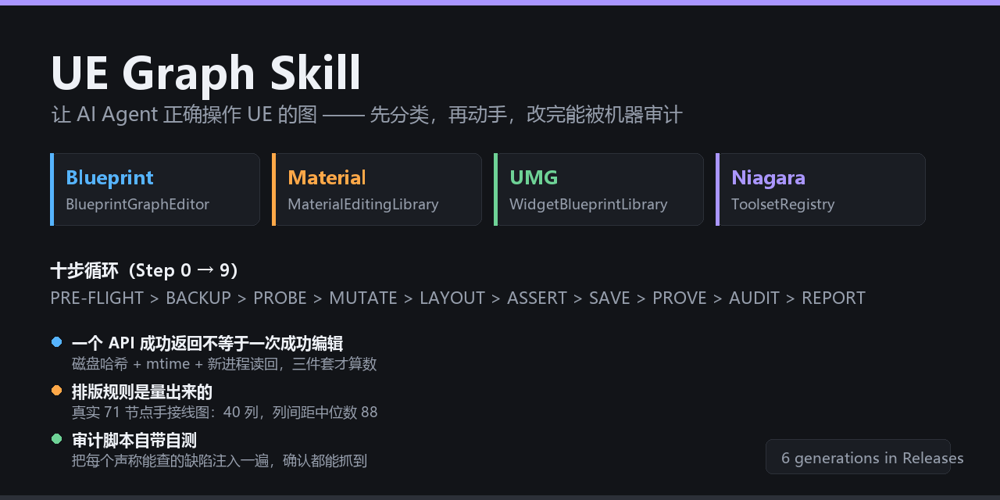

# Agent Skill —— Unreal Engine 蓝图 / 材质 / UMG / Niagara 图操作



> 一套给 AI Agent 用的 **Unreal Engine 5.8 图操作技能包**：先用 Python 判断你在操作哪种子系统，
> 再按对应子系统的正确 API 去建图、改图、审计图，最后把图画成**手接线的样子**而不是把节点全丢在原点。

[](https://www.unrealengine.com)
[]()
[]()
[]()

---

## 这是什么

不是插件，不是代码库，而是一份**给 Agent 读的技能说明 + 参考手册 + 可执行脚本**。
装上之后，Agent 在处理「改一个蓝图」「加个节点」「这图为什么看起来很乱」这类任务时，
会照着这里的规则做，而不是凭印象调 API。

技能的核心假设很朴素：**UE 里"图"有四种，它们长得像、代码几乎不共用**。

```
Material / MaterialFunction / MaterialInstance   →  unreal.MaterialEditingLibrary
NiagaraSystem / NiagaraEmitter                   →  ToolsetRegistry
WidgetBlueprint / UMG                            →  WidgetBlueprintLibrary
Blueprint / 事件图 / 函数图                       →  BlueprintGraphEditor
Level / 地图 / Actor / 配置                       →  EditorActorSubsystem, ini
```

**走错路的代价极高** —— 用 `BlueprintTools` 去改材质、用 `BlueprintGraphEditor` 去改 UMG，
报错信息通常只有一句 `not a valid object path` 或 `no attribute ...`，看不出是路由错了。
所以 v2 的第一条规则是：**先路由，再动手**。

---

## 执行循环（Step 0 → 9，十步）

```
0. PRE-FLIGHT   编辑器关掉 / 进程干净 / 资产可写 / 有回滚空间
1. BACKUP       把 .uasset 拷出来，记录大小 + SHA256
2. PROBE        探真实的 node id、函数路径、pin 名 —— 绝不猜
3. MUTATE       按路由调对应库；建图、建节点、连 pin
4. LAYOUT       把手接线的排布规则套上去
5. ASSERT       错误节点列表为空 → 编译 → 状态是 BS_UP_TO_DATE
6. SAVE         同一次运行里保存
7. PROVE        磁盘 SHA256 变了 + mtime 变了 + 新开进程读回来还是新的
8. AUDIT        对 dump 跑 scripts/analyze_graph_layout.py
9. REPORT       说清验证了什么，以及明确说清没能验证什么
```

第 4 步和第 8 步是 v2 新增的。**一个能编译但读不懂的图，是次品交付。**

---

## 手接线风格（实测得出，不是拍脑袋）

从本项目里一张真实的 71 节点手接材质图上量出来的：

| 规则 | 实测依据 |
|---|---|
| **HW1** 源节点堆在最左边**一列** | 71 个节点里有 19 个挤在 `x=-4600` 那一列 |
| **HW2** 从左到右流，每列约 1–2 个节点 | 71 个节点铺了 40 列 |
| **HW3** 间距**双向**都有限制 | 相邻列间距 4..300，中位数 88，**没有一个超过 400** |
| **HW4** 坐标零重合 | 实测 0 |
| **HW5** 每个节点都参与流程 | 实测 0 个孤立空节点 |
| **HW6** 非源节点的输入必须接上 | — |
| **HW7** 只有源节点和根引脚节点可以悬空 | — |

### 最容易误判的缺陷：节点铺得太开

两种"长线"看起来一样，但**不是一回事**：

| 连线 | 可接受长度 | 原因 |
|---|---|---|
| 处理节点 → 它的消费者（级到级） | 短，中位数 **296**，别超过 ~300 | 太长说明你漏了一个级位置 |
| 最左源 → 靠后的消费者 | 长是正常的，实测到 **3200** | 源列是刻意做的共享池 |

**所以千万别为了"修长线"把源节点搬出左列** —— 那是拿一个外观问题换一个结构问题。
真正的缺陷是**处理级之间的间距过大**：如果你的级距是 600+，6 级链路就超过 1920 像素视口，
用户读一条链要平移。实测平均是**每级 97 单位**。

配套审计工具 `scripts/analyze_graph_layout.py` 会自动查：坐标重合、孤立空节点、断开的输入、
死端、可达性、列间距，然后给 PASS/FAIL。它做过自测：**把每一种它声称能查的缺陷都注入一遍**，
确认都能抓到（包括一个假阳性守卫：合法的根引脚节点不能误报成"空节点"）。

```
nodes=71 columns=40 widest=19 (at x=-4600)
reachable=71/71 (100.0%)  roots=7
EXACT COLLISIONS=0  empty_isolated=0  broken_inputs=0  dead_ends=0
spacing: median gap=88  max gap=300
VERDICT: PASS (no blocking defect)
```

---

## 九条不可妥协的规则

1. **API 返回成功 ≠ 编辑成功。** 每次写入都要用「磁盘哈希变化 + mtime 变化 + 新进程读回」三件套证明。
2. **任何写入都必须先关编辑器。**
3. **破坏性操作前必须备份。** `Saved/` 下的 `<Asset><GUID>.tmp` 是合法包，是你的回滚路径。
4. **绝不用编的 node id、函数路径、pin 名、调色板分类。** 先探。
5. **每次写入后检查错误节点列表**，再编译，再断言 `BS_UP_TO_DATE`。
6. **不要回环绕回**（`write(read(g))`）—— 读回是渲染结果，不是源。
7. **必须在新进程里验证。** 同会话的自检会撒谎。
8. **你建的东西你要排版。** 读不懂的图是次品。
9. **说清你没能验证什么。** 渲染效果、真实输入、已构建的 Slate 控件，在无头环境里是查不了的。

---

## 文件说明

| 我想…… | 读这个 |
|---|---|
| 判断我在哪个子系统 | `references/00-router.md` |
| 查 Blueprint 方法的确切签名 | `references/10-api.md`、`references/blueprint_api.json` |
| 把参数格式搞对 | `references/11-parameter-formats.md` |
| 抄一个能跑通的流程 | `references/12-templates.md` |
| 驱动编辑器 / 排查"静默无操作" | `references/13-driver.md` |
| 硬性规则 + 50 条陷阱目录 | `references/20-rules.md` |
| 手接线排布的实测数据 | `references/40-hand-wired-style.md` |
| 材质 / UMG / Niagara 的具体差异 | `references/45-material-and-other-graphs.md` |
| 摸到 Niagara、材质、地图、Actor、C++ 桥 | `references/21-adjacent-systems.md` |
| 知道每条结论从哪来 | `references/30-provenance.md` |
| 审计一个图的排版 | `scripts/analyze_graph_layout.py` |
| dump 一张材质图 | `scripts/DumpMaterialGraph.py` |
| 在编辑器里跑单条脚本 | `scripts/run_one.py` |

```
AgentSkill_UEBluePrint/
├─ SKILL.md                      技能入口（Agent 第一个读的文件）
├─ references/
│  ├─ 00-router.md               先路由：五条路线 + 走错路的症状表
│  ├─ 10-api.md                  Blueprint 图 API 与签名
│  ├─ 11-parameter-formats.md    参数格式（最容易错的地方）
│  ├─ 12-templates.md            可复制的流程模板
│  ├─ 13-driver.md               编辑器驱动与"静默无操作"排查
│  ├─ 20-rules.md                硬规则 + 50 条陷阱
│  ├─ 21-adjacent-systems.md     Niagara / 材质 / 地图 / Actor / C++ 桥
│  ├─ 30-provenance.md           每条结论的来源与置信度
│  ├─ 40-hand-wired-style.md     实测手接线排版规则
│  ├─ 45-material-and-other-graphs.md
│  └─ blueprint_api.json         机器可读的 API 表（67 KB）
├─ scripts/
│  ├─ analyze_graph_layout.py    图排版审计 + 自测
│  ├─ DumpMaterialGraph.py       材质图 dump 成 JSON
│  └─ run_one.py                 在编辑器里执行单条脚本
└─ research/                     其他 UE MCP 项目的调研笔记（写作时的参考）
```

---

## 六代演进

这个技能不是一次写成的。仓库的 **Release 里按时间顺序放了全部六代**，可以直接看到每一代改了什么。

| # | 代 | 文件 | 体积 | 这一代做了什么 |
|---|---|---|---|---|
| 1 | `UE_BP_Skill_Pre0` | 8 | 49 KB | 第一版：把一次真实项目的经验直接写成 `SKILL.md` + `rules.md` + `templates.md`，配一个单体脚本 `ue_bp.py`（共享 helper）和 `run_one.py` |
| 2 | `UE_BP_Skill_Pre1` | 5 | 43 KB | 拆结构：`SKILL.md` 保持精简，内容移进 `references/`；补上 `MCP_DESCRIPTION.md` |
| 3 | `UE_BP_Skill_Pre2` | 5 | 87 KB | 引入**机器可读**：新增 `blueprint_api.json`（45 KB），把 API 从散文变成可查表 |
| 4 | `UE_BP_Skill_Pre3` | 4 | 86 KB | 实测扩充：`ue-bp-ops.md` 涨到 26.8 KB，`mcp.md` 涨到 22.6 KB，补进大量实测记录 |
| 5 | `ue-bp-skill-test` | 10 | 157 KB | 重新编号组织：`10-api` / `11-parameter-formats` / `12-templates` / `13-driver` / `20-rules` / `21-adjacent-systems` / `30-provenance`，API 表扩到 67 KB |
| 6 | **`ue-bp-skill-v2`** | **15** | **217 KB** | **最终版**：新增 `00-router`（先路由）、`40-hand-wired-style`（实测排版规则）、`45-material-and-other-graphs`，以及排版审计脚本 `analyze_graph_layout.py` |

**演进的主线**：散文经验 → 结构化的散文 → 机器可读的表 → 实测数据 → **先分类再动手 + 可审计的排版**。

---

## 安装 / 使用

这是一个 Agent Skill，不是一个 UE 插件。装到你的 agent 技能目录即可，或直接把 `SKILL.md`
与 `references/` 喂给模型：

```powershell
# 示例：DSH 的技能目录
Copy-Item -Recurse .\* "$env:USERPROFILE\.dsh\skills\ue-bp-skill-v2\"
```

用的时候，Agent 应当：

1. 先读 `SKILL.md`，按 **Step 0** 做路由
2. 按 **Step 1** 的十步循环（Step 0 → 9）执行
3. 遇到具体问题查 `references/` 里对应的文件
4. 改完图之后跑一次排版审计

审计脚本可以独立使用：

```powershell
<python> scripts/analyze_graph_layout.py graph-dump.json
<python> scripts/analyze_graph_layout.py --self-test   # 验证工具本身能抓到每一个缺陷
```

---

## 诚实声明

- **排版数字来自单一样本**（一张 71 节点材质图）。「单列源、从左到右、无重合、无孤立、间距有界」这些**形状**结论是可靠的；`88 / 296 / 300` 这些**具体数值是可校准的**，随着审计更多图应当重新测量。
- **无头环境验不了的东西**：最终渲染、真实输入、已构建的 Slate 控件。技能里明确要求 Agent 说清这一点，而不是含糊过去。
- `research/` 里的文件是写作时对其他 UE MCP 项目的调研笔记，**不是本技能的实现**，版权归各自作者。

---

## 许可

MIT。
